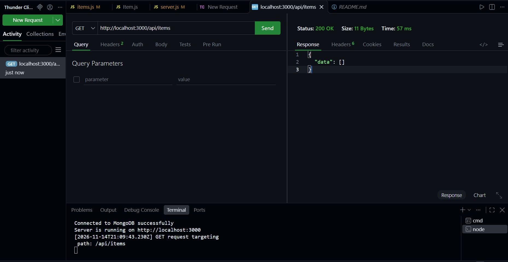
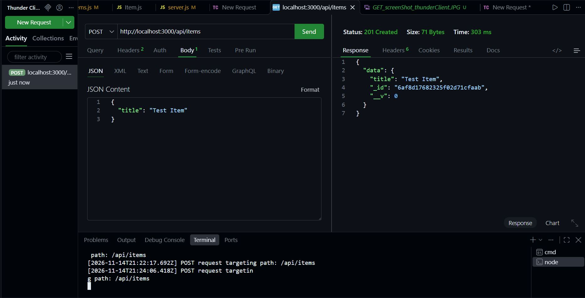
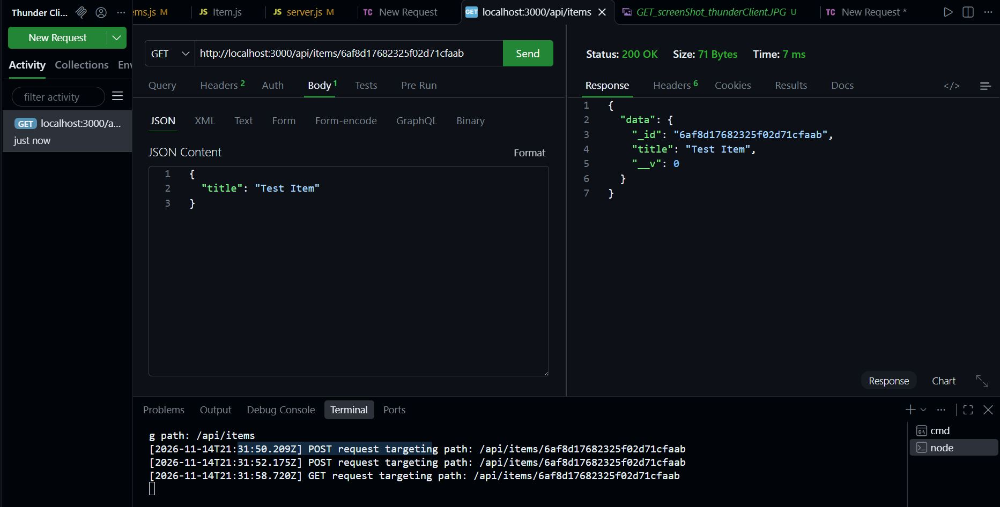
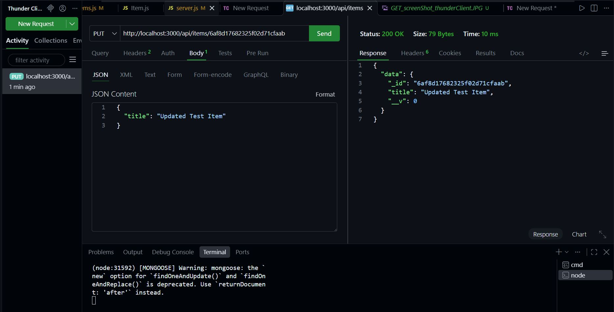
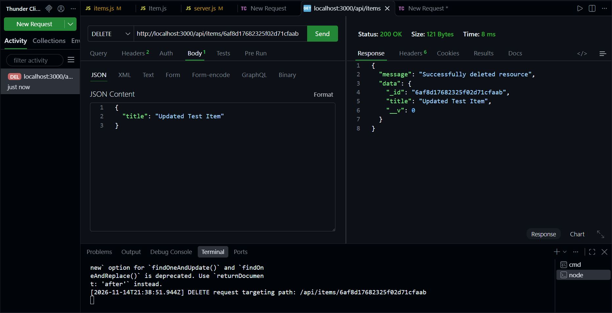

1. **GET /api/items** 

Status Code: 200 OK
Description: Retrieved all persistent records from the MongoDB collection, in this case it displayed data[] since it stored nothing at the time.
**Screenshot:** 

2. **POST /api/items**
Status Code: 201 Created
Description: Validates the incoming request body properties, then saves a new item docuemnt to the database.
**Screenshot:**

3. **GET /api/items/:id**
Status Code: 200 OK
Description: Queries a single item by its unique MongoDB document identifier.
**Screenshot:**

4. **PUT /api/items/:id**
Status Code: 200 OK
Description: Modifies an existing item record by its ID using Mongoose update scripts.
**Screenshot:**

5. **DELETE /api/items/:id**
Status Code: 200 OK
Description: Permenantly removes the target entry matching the provided ID from the database collection.
**Screenshot:**

